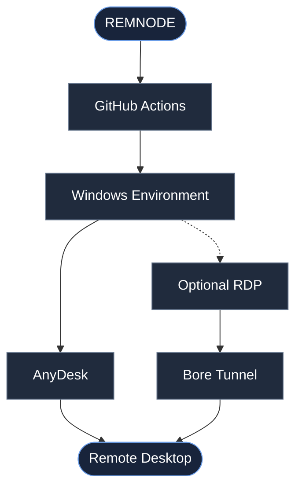

  

<h1 align="center">REMNODE</h1>

  <strong>YOUR DESKTOP. YOUR SESSION. YOUR CONTROL.</strong>

  A temporary Windows remote desktop environment, powered by GitHub Actions.

---

## The experience

https://github.com/user-attachments/assets/7f7895c7-4c6a-41a8-ad27-a1a936fee363

## Overview

Remnode brings together a Windows environment and remote desktop connectivity in one on-demand workflow.

## What makes Remnode

|  | Feature | Description |
|:--:|---|---|
| ◈ | **Windows** | Windows environment on a hosted runner |
| ◉ | **AnyDesk** | Remote desktop connectivity |
| ⇄ | **RDP** | Optional alternative connection |
| ⚡ | **On demand** | Manually launch a session |
| ◇ | **Secret support** | AnyDesk password from GitHub Actions secrets |
| ⏱ | **Extended runtime** | Up to 360 minutes configured job timeout |

## Specifications

| | |
|---|---|
| **Platform** | Windows |
| **Runner** | `windows-latest` |
| **Automation** | GitHub Actions |
| **Launch mode** | Manual |
| **Remote access** | AnyDesk |
| **Optional access** | RDP via Bore |
| **Maximum job timeout** | 6 hours |

---

  <strong>REMNODE</strong>
   
  Simple. Remote. On demand.

