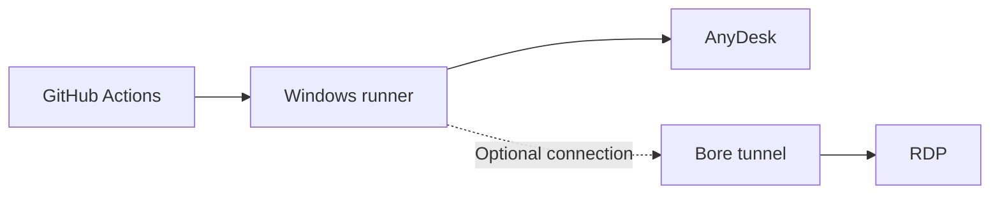

  

<h1 align="center">REMNODE</h1>

  <strong>Your Windows desktop. On demand.</strong>

  A temporary remote Windows environment powered by GitHub Actions.

  <strong>SPIN UP · CONNECT · GET THINGS DONE</strong>

---

## Live preview

https://github.com/user-attachments/assets/7f7895c7-4c6a-41a8-ad27-a1a936fee363

---

## Built for remote access

| Capability | Details |
|:--|:--|
| **Windows environment** | GitHub-hosted `windows-latest` runner |
| **On-demand launch** | Manually triggered workflow |
| **Primary connection** | AnyDesk remote desktop |
| **Alternative connection** | Optional RDP through a Bore tunnel |
| **Unattended access** | AnyDesk password supplied through a GitHub Actions secret |
| **Session duration** | Configured job timeout of up to 360 minutes |

## Connection map

## Features

<table>
  <tr>
    <td width="50%">
      <h3>01 · Windows desktop</h3>
      A Windows environment running on a GitHub-hosted runner.
    </td>
    <td width="50%">
      <h3>02 · AnyDesk access</h3>
      Connect to the desktop remotely using AnyDesk.
    </td>
  </tr>
  <tr>
    <td width="50%">
      <h3>03 · Optional RDP</h3>
      An alternative Remote Desktop connection through Bore.
    </td>
    <td width="50%">
      <h3>04 · On-demand sessions</h3>
      Start a session manually whenever you need one.
    </td>
  </tr>
  <tr>
    <td width="50%">
      <h3>05 · Secret integration</h3>
      Uses `REMNODE_ANYDESK_PASSWORD` from GitHub Actions secrets.
    </td>
    <td width="50%">
      <h3>06 · Extended runtime</h3>
      A configured job timeout of up to six hours.
    </td>
  </tr>
</table>

## Technical overview

| Property | Value |
|:--|:--|
| Project | Remnode |
| Platform | Windows |
| Runner | `windows-latest` |
| Workflow trigger | `workflow_dispatch` |
| Remote desktop | AnyDesk |
| Optional protocol | RDP |
| Tunnel | Bore |
| Job timeout | 360 minutes |

## Important

Remnode uses a temporary hosted runner. When its GitHub Actions job ends, the runner is decommissioned. Data stored only on that runner should be treated as temporary.

---

  <strong>REMNODE</strong>
   
  A remote desktop, ready when you need it.

